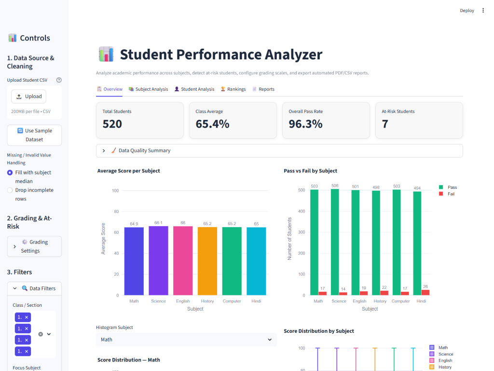
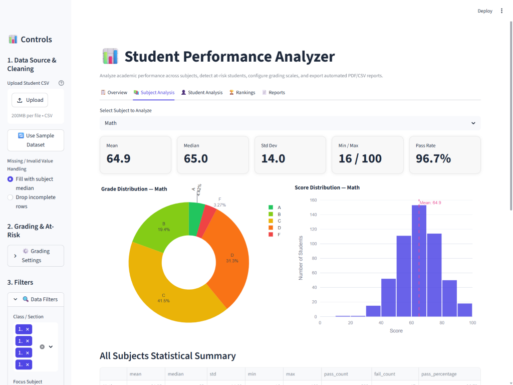
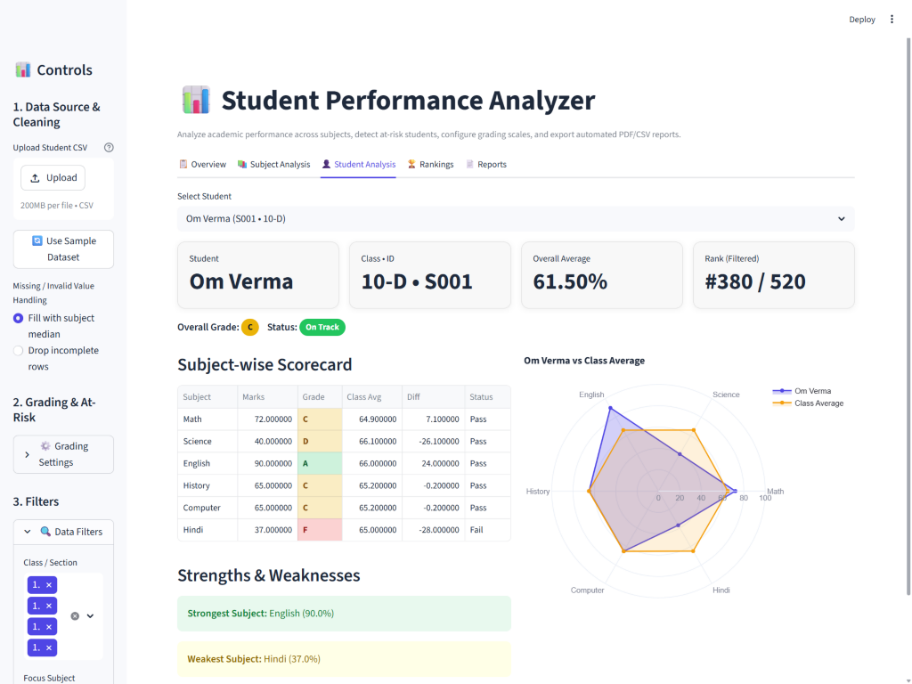
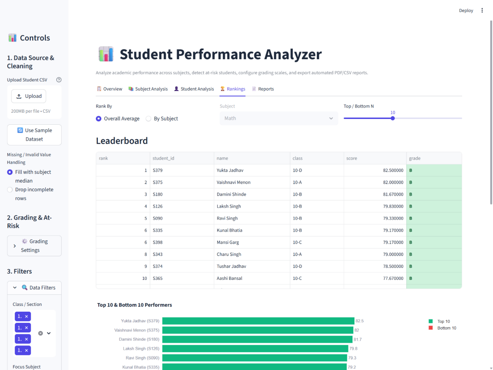

# 📊 Student Performance Analyzer

An interactive data analytics dashboard built with **Python**, **Streamlit**, **Pandas**, **Plotly**, and **FPDF2** to analyze students' academic performance across subjects, detect at-risk learners, customize grading criteria, and generate automated CSV and PDF reports.

---

## ✨ Features

- **Data Upload & Automated Cleaning**
  - Upload any student marks CSV or explore immediately with the built-in 530-row sample dataset (`data/sample_students.csv`).
  - Validates required schema columns (`student_id`, `name`, `class`, `math`, `science`, `english`, `history`, `computer`, `hindi`).
  - Detects and fixes invalid marks (non-numeric, negative, or `> 100`), deduplicates by `student_id`, and handles missing values via configurable **median imputation** or **row dropping**.
  - Displays a **Data Quality Summary** showing rows processed, duplicates removed, invalid values fixed, and missing values handled.
- **Statistical Analysis**
  - Per-subject descriptive statistics: mean, median, standard deviation, min, max, pass/fail counts, and pass percentage.
  - Overall and subject-wise student rankings with tie handling.
  - Pearson correlation matrix across subjects.
  - Individual student strengths and weaknesses detection.
  - Configurable **At-Risk Student Detection** (e.g., scoring below pass mark in 2+ subjects).
- **Interactive Plotly Visualizations**
  - Subject average bar chart and Pass vs. Fail grouped bar chart.
  - Score distribution histograms with mean indicators and cross-subject box plots.
  - Annotated subject correlation heatmap.
  - Student vs. Class Average radar chart.
  - Top/Bottom performers horizontal bar chart and subject grade distribution donut charts.
- **Configurable Grading & Filters**
  - Live sidebar sliders for **A / B / C / D / F grade boundaries**, **pass mark**, and **at-risk thresholds** that dynamically update KPIs, tables, charts, and reports.
  - Filter by class/section, focus subject, average score range, and student name/ID search.
- **Automated CSV & PDF Reports**
  - Export cleaned student records and subject statistical summaries as CSV.
  - Generate a **Class Performance PDF Report** (with summary KPIs, subject stats, embedded Plotly charts via Kaleido, top/bottom rankings, and at-risk student list).
  - Generate an **Individual Student Report Card PDF** with subject-wise scorecard, comparison vs. class average, strengths/weaknesses, and radar chart.

---

## 📁 Project Structure

```text
Student performance analyzer/
├── app.py                      # Streamlit entry point (sidebar, KPIs, 5 tabs)
├── requirements.txt            # Python dependencies
├── README.md                   # Documentation
├── .streamlit/
│   └── config.toml             # Custom theme & server settings
├── data/
│   └── sample_students.csv     # Seeded sample dataset (530 rows, 6 subjects)
├── src/
│   ├── __init__.py
│   ├── cleaning.py             # Schema validation, deduplication, imputation
│   ├── grading.py              # Configurable grade boundaries & color mapping
│   ├── analysis.py             # Stats, rankings, correlation, strengths, at-risk
│   ├── charts.py               # Shared-theme Plotly visualizations
│   └── reports.py              # CSV & FPDF2 PDF report generation
└── tests/
    ├── __init__.py
    ├── test_cleaning.py        # Unit tests for data cleaning
    └── test_grading.py         # Unit tests for grading logic
```

---

## 🚀 Setup & Installation

1. **Clone or download the repository**
   ```bash
   cd "Student performance analyzer"
   ```

2. **Create and activate a virtual environment (recommended)**
   ```bash
   python -m venv .venv
   # Windows
   .venv\Scripts\activate
   # macOS / Linux
   source .venv/bin/activate
   ```

3. **Install dependencies**
   ```bash
   pip install -r requirements.txt
   ```

4. **Run unit tests**
   ```bash
   pytest -v
   ```

5. **Launch the Streamlit dashboard**
   ```bash
   streamlit run app.py
   ```

---

## ☁️ Deploying to Streamlit Community Cloud

1. Push this project folder to a GitHub repository.
2. Go to [share.streamlit.io](https://share.streamlit.io) and sign in with GitHub.
3. Click **New app**, select your repository/branch, and set the main file path to `app.py`.
4. Click **Deploy** — Streamlit Community Cloud will automatically install dependencies from `requirements.txt` and apply `.streamlit/config.toml`.

---

## 📸 Screenshots

### Overview & KPI Cards


### Subject Analysis & Distribution


### Student Radar & Scorecard


### Rankings & Top/Bottom Performers

